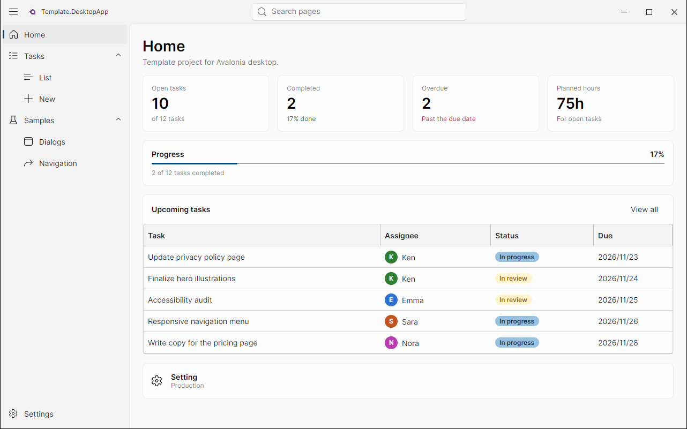
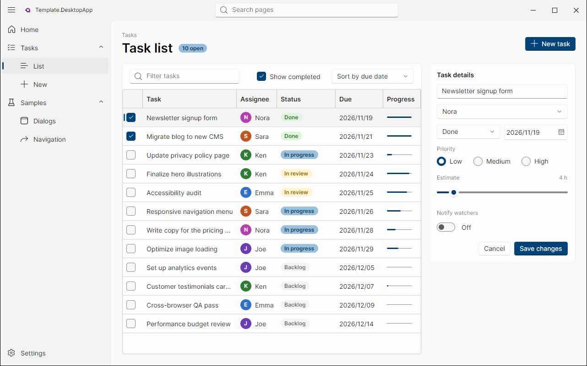
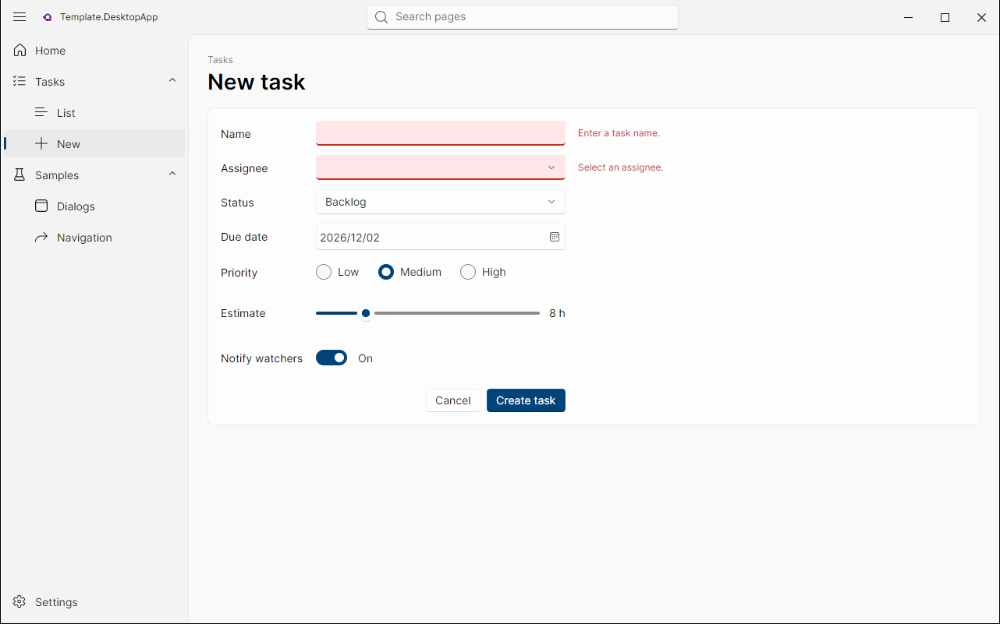
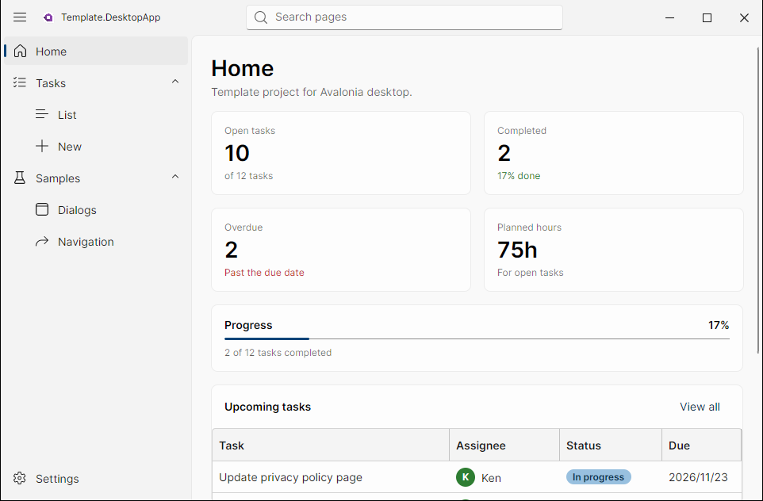
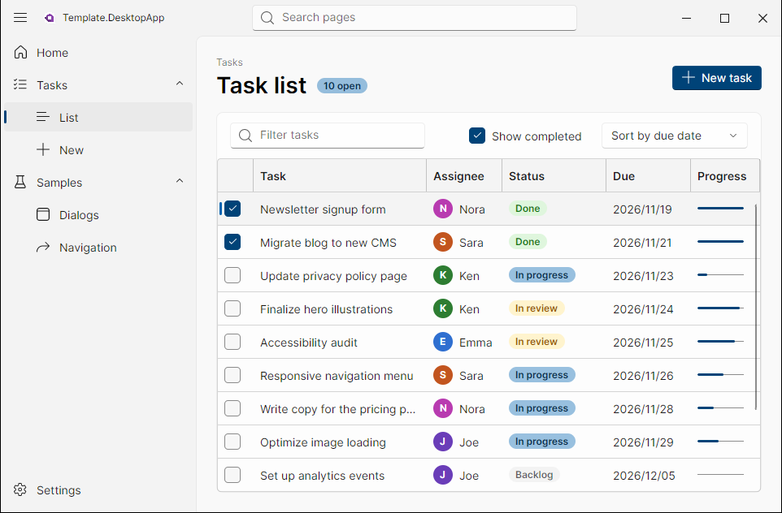
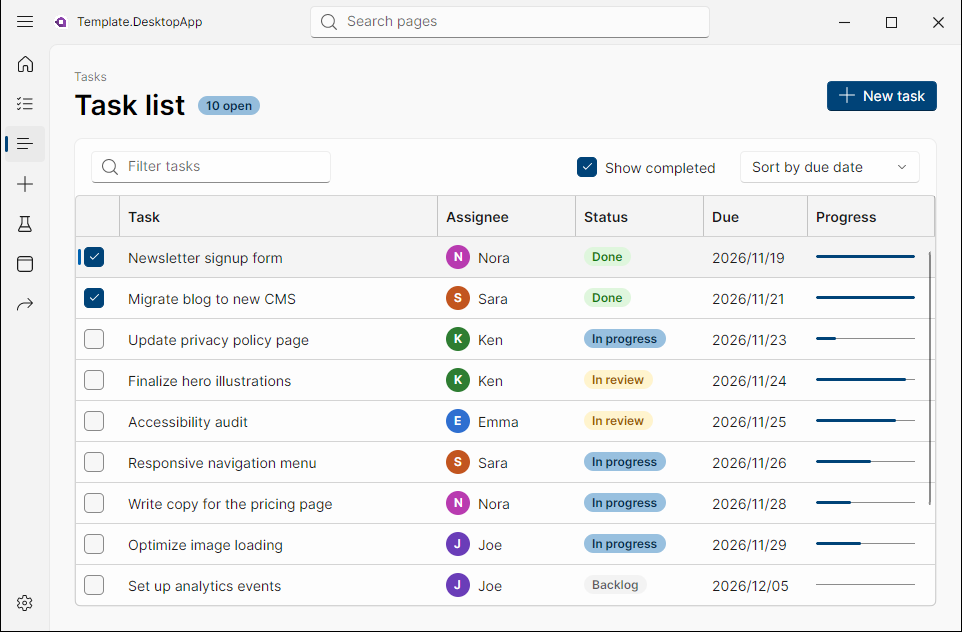
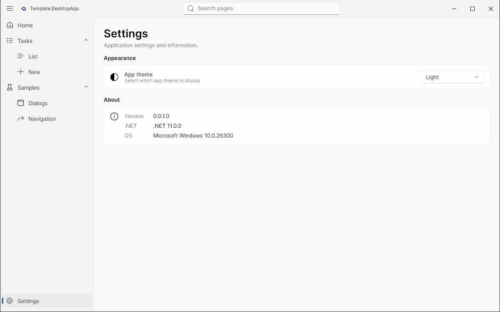
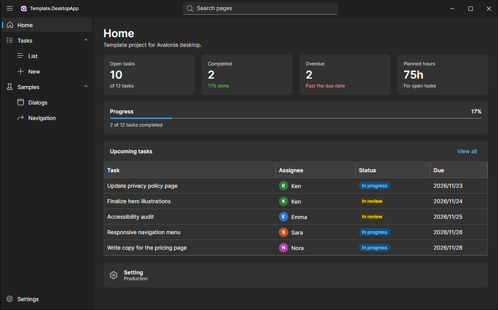
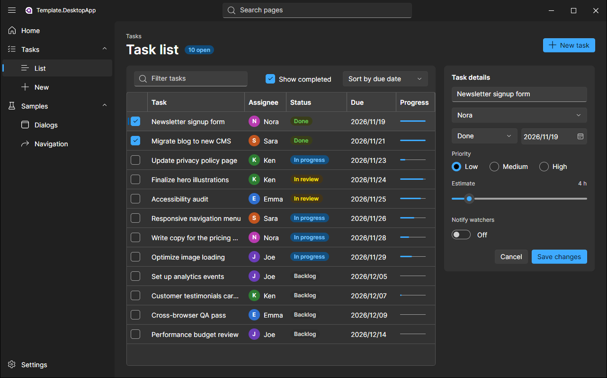

# Template project for Avalonia desktop

[Template](https://usausa.github.io/template/) project for Avalonia desktop.

# 📸 Image

# ✅ Implement

| Category | Feature |
| --- | --- |
| Window | Fluent2 theme (Light / Dark / System) / Custom title bar / Window placement / Inter font / Fluent UI System Icons / Compiled bindings |
| Shell | Side navigation (groups, collapsible pane) / Page search / Responsive layout (container queries) |
| Example | Dashboard / Table with detail editing (TableView) / Form with validation |
| Basic | MVVM (source generator) / Navigation / Dialog (confirm, input, notice) / Setting / User setting (JSON) / Logging (Serilog) / DI (source generator) / Leak detection |
| App | Generic Host / Unhandled exception handling / Startup log / DevTools (Debug) |

# 🔗 Related Projects

| Project | Description |
| --- | --- |
| [template-wpf](https://github.com/usausa/template-wpf) | WPF desktop application template |
| [template-avalonia-embedded](https://github.com/usausa/template-avalonia-embedded) | Avalonia application template for Raspberry Pi embedded devices |
| [template-avalonia-linux](https://github.com/usausa/template-avalonia-linux) | Avalonia application template for Linux kiosk terminals |

# 📦 My Libraries

| Library | Description |
| --- | --- |
| [Usa.Smart.Mvvm](https://github.com/usausa/Smart-Net-Mvvm) | MVVM |
| [Usa.Smart.Reactive](https://github.com/usausa/Smart-Net-Reactive) | Reactive Extensions helpers |
| [Usa.Smart.Navigation](https://github.com/usausa/Smart-Net-Navigation) | Navigation |
| [Usa.Smart.Avalonia](https://github.com/usausa/Smart-Net-Avalonia) | Avalonia MVVM helpers |
| [Usa.Smart.Mapper](https://github.com/usausa/Smart-Net-Mapper) | Object mapper |
| [BunnyTail.DependencyInjection](https://github.com/usausa/bunnytail-dependency-injection) | Source generator based DI |
| [BunnyTail.XamlProperty.Avalonia](https://github.com/usausa/bunnytail-xaml-property) | StyledProperty generator |
